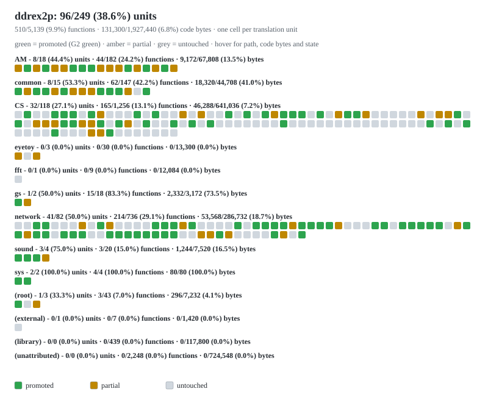

# DDR Extreme 2 (US) preview



A matching decompilation of *Dance Dance Revolution Extreme 2 (US)* for the PlayStation 2.

This repository does **not** contain any game assets, retail code or disassembly. An existing copy of the game is required.

Supported version: `SLUS_211.74`, sha256 `ef31c90f321328906c51144152d68676975b52cf157b3adb65aa1969a97c02cd`.

Requirements
============

Python 3.11+, ninja, a MIPS binutils, `splat` and `objdiff-cli`; `python3 tools/toolchain/check_deps.py` names anything missing. [wibo](https://github.com/decompals/wibo) is fetched automatically on macOS and Linux.

macOS
-----

- `brew install mips-linux-gnu-binutils ninja`
- `python3 -m pip install --user 'splat64[mips]' pytest`
- `curl -sL -o ~/.local/bin/objdiff-cli https://github.com/encounter/objdiff/releases/download/v3.8.2/objdiff-cli-macos-arm64 && chmod +x ~/.local/bin/objdiff-cli`

Linux (x86_64)
--------------

- `sudo apt install build-essential ninja-build binutils-mips-linux-gnu`
- `python3 -m pip install --user 'splat64[mips]' pytest`
- Same release, the `objdiff-cli-linux-x86_64` asset.

Windows (x86_64)
----------------

- Native tooling; WSL and msys2 are not needed.
- `winget install Python.Python.3.12 Ninja-build.Ninja`, then `python -m pip install --user splat64[mips] pytest`.
- Same release, the Windows asset. The CodeWarrior tools are Windows binaries, so nothing is emulated; call the driver as `python ddr <verb>`.

Building
========

- Fetch the compilers, hash-verified: `python3 tools/toolchain/fetch.py 2.4-001213 3.0-011126`
- Copy your retail ELF to `orig/SLUS_211.74`.
- Build and check: `./ddr build && ./ddr verify`
- G3 only: place the disc image at its path in `config/targets.py`, then `./ddr verify --iso`.

Verifying
=========

|gate|command|proves|
|---|---|---|
|G1|`./ddr verify`|the built ELF's sha256 equals the retail ELF's|
|G2|`./ddr verify --tu <unit>`|that unit's `.text`, `.debug` chunk and `.line` chunks equal retail's|
|G3|`./ddr verify --iso`|splicing the built ELF into the image reproduces the image|

A red gate is never worked around: the tool names the unit, function and chunk that own the first divergent byte.

Progress
========

<!-- status:start -->

**Overall: 38 / 249 translation units promoted (15.3%); 212 / 4,463 functions reconstructed (4.75%); 45,168 / 1,631,596 code bytes reconstructed (2.77%).**

Green means a unit is **promoted** — this is not a draft count.  It has a source at its manifest path, a `tu_builds` row recording the compiler and flags it was measured with, and a green `./ddr verify --tu` verdict: its `.text` span, its `.debug` chunk and its `.line` chunks are retail's bytes.  Amber is **partial** — a draft named like the unit exists on some branch, or a source exists without a `tu_builds` row (or its verdict is not green).  Grey is **untouched**.

**Code bytes are function sizes declared by the splits** (`nonmatching <fn>, 0xNN`), so debug information and data are excluded; a promoted unit contributes its pinned `.text` size (each function's span rounded to MWCC's 16-byte function alignment).  Split code no compile unit claims is `(library)` when the symbol has a name and `(unattributed)` when it is still `func_*`.

Regenerate both this table and [`docs/status.svg`](docs/status.svg) with `python3 tools/units/status.py --target ddrex2p`; `python3 tools/units/status.py --check` fails when either is stale.  The heatmap has one cell per translation unit, grouped by module; hover a cell for its path, code bytes and state.

| module | units | promoted units | functions | reconstructed functions | code bytes | reconstructed bytes | units % | functions % | bytes % |
|---|---:|---:|---:|---:|---:|---:|---:|---:|---:|
| `AM` | 18 | 8 | 182 | 44 | 67,808 | 9,424 | 44.4% | 24.18% | 13.90% |
| `common` | 15 | 4 | 147 | 41 | 44,708 | 11,408 | 26.7% | 27.89% | 25.52% |
| `CS` | 118 | 11 | 814 | 59 | 433,844 | 13,536 | 9.3% | 7.25% | 3.12% |
| `eyetoy` | 3 | 0 | 30 | 0 | 13,300 | 0 | 0.0% | 0.00% | 0.00% |
| `fft` | 1 | 0 | 9 | 0 | 12,084 | 0 | 0.0% | 0.00% | 0.00% |
| `gs` | 2 | 1 | 18 | 15 | 3,172 | 2,416 | 50.0% | 83.33% | 76.17% |
| `network` | 82 | 8 | 542 | 43 | 208,732 | 6,720 | 9.8% | 7.93% | 3.22% |
| `sound` | 4 | 3 | 20 | 3 | 7,520 | 1,264 | 75.0% | 15.00% | 16.81% |
| `sys` | 2 | 2 | 4 | 4 | 80 | 96 | 100.0% | 100.00% | 120.00% |
| `(root)` | 3 | 1 | 43 | 3 | 7,232 | 304 | 33.3% | 6.98% | 4.20% |
| `(external)` | 1 | 0 | 7 | 0 | 1,420 | 0 | 0.0% | 0.00% | 0.00% |
| `(library)` | 0 | 0 | 439 | 0 | 117,800 | 0 | 0.0% | 0.00% | 0.00% |
| `(unattributed)` | 0 | 0 | 2,208 | 0 | 713,896 | 0 | 0.0% | 0.00% | 0.00% |
| **total** | **249** | **38** | **4,463** | **212** | **1,631,596** | **45,168** | **15.3%** | **4.75%** | **2.77%** |

Legend: green = promoted (G2 green); amber = partial (draft or source, unproven); grey = untouched.

<!-- status:end -->

Everyday commands
=================

```sh
./ddr build                     # configure + ninja: split, assemble, compile, link, G1
./ddr verify --tu sys_scf       # G1 plus that unit's promotion verdict
./ddr diff sysInitScf sys_scf   # retail's bytes for one symbol against our object
python3 -m pytest -q tests      # the suite runs the real tools, not stubs
```

Unit work: `tools/units/line_map.py`, `twins.py`, `measure.py`, `m2c_draft.py`, `slots.py`, `permute.py`.

Docs
====

- [`AGENTS.md`](AGENTS.md) — the operating contract: the rules, the loop, why each exists.
- [`docs/unit-work.md`](docs/unit-work.md) — how a unit is promoted, and the measured codegen rules.
- [`docs/`](docs) — the design, the milestones, and the measured codegen rules.

Credits
=======

- [splat](https://github.com/ethteck/splat), [wibo](https://github.com/decompals/wibo), [objdiff](https://github.com/encounter/objdiff), [m2c](https://github.com/matt-kempster/m2c), [decomp-permuter](https://github.com/simonlindholm/decomp-permuter), and the [dtk-template](https://github.com/encounter/dtk-template) layout.
