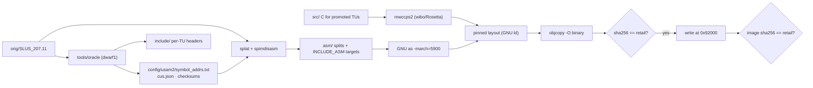

# DDRMAX2 US — matching decompilation design

**Date:** 2026-10-14
**Target:** `SLUS_207.11` — *DDRMAX2: Dance Dance Revolution* (USA), PlayStation 2, Konami, 2003.
**Status:** design approved in conversation; target build confirmed. Implementation plan to follow via the writing-plans skill.

---

## 1. Goal and success criteria

Reconstruct the game's C source so that compiling it with the original toolchain, linking it with pinned
library objects, and writing the result back into the retail disc image reproduces **the retail artifacts
byte for byte**.

Three machine-checkable gates, in order of strength:

| gate | check |
|---|---|
| G1 binary | `out/SLUS_207.11` sha256 == retail `SLUS_207.11` sha256 (**whole file**, `.debug`/`.line`/`.comment`/headers included) |
| G2 per-TU | the diagnostic that localises a G1 failure: for a promoted TU, compare its `.text` and its `.debug`/`.line` chunk against retail and name the first divergence. A green G1 implies a green G2 for every TU |
| G3 disc | writing the built ELF into the retail image at byte offset `0x92000` reproduces the image byte for byte |

Human-readable reconstruction is part of the goal, not a nicety: names, types, file names and line
numbers come from the retail binary's own debug information wherever it survives, and every symbol's
provenance is recorded.

## 2. Target facts (measured)

| property | value |
|---|---|
| ELF size / sha256 | 2,512,980 B / `a7596e8ab3da823236ed8e5f3f2804db3daee47265ae73e22f3311a5218aa8cc` (md5 `ab61ce41a24f419fd19f0c3885b3b58b`) |
| machine / e_flags | MIPS R5900 (Emotion Engine), little-endian, `e_flags 0x20924000`, entry `0x100008`, base `0x00100000` |
| loadable image | one PROGBITS section, flags `RWX`, `0x00100000`, file offset `0x80`, size **1,713,792** (text + data + rodata in one region) |
| bss marker | `0x6b6b80`, size 0; `$gp` from `.reginfo` = `0x2a84f0` |
| debug | `.debug` 657,815 B (**DWARF version 1**, `SHT_MIPS_DEBUG`), `.line` 140,704 B |
| stripped | `.symtab` and `.strtab` present but **size 0**; no `.mwcats`, no `.mdebug` |
| compiler linker string | `.comment` = `MW MIPS C Compiler (2.4.1.01)` + `PlayStation2` — emitted by **MWLD**, shared across R2.5→R3.04, so it identifies the linker family, not the compiler build |
| DWARF content | 16,125 DIEs, **480 compile units = 57 translation units + 423 function units**, 818 aggregate DIEs (123 distinct names), 1,586 locals, 577 parameters, 639 globals/statics, 423 line tables, `0 sibling/length problems` |
| decompilable surface | **423 functions across 57 `.c` files** under `C:\work\usam2\src` |
| library region | ~2,670 functions outside the DWARF-described range, unnamed (SDK/newlib/libgcc) |
| source tree | `usam2/src` + `AM/s573/{disp,doll,play}` (12 doll files), `CS/{lesson,endless,records,option,edit,diet,opening,staffroll}`, `gs`, `sys`, `music_all.c` |
| SDK generation | disc IOP modules report `IOPRP254.IMG` and `PsII* 2540/2500` — the `IOPRP254` era |
| retail image | 1,244,823,552 B, 2048-byte sectors; ELF at LBA 292 = byte `0x92000`; image sha256 `b8519c9106b43cc83bc57948cbc02a83851d3182fcbd4e7d341c573758bb3ec8`; system area filled `0x3D` |

## 3. Scope boundary

**In scope:** the 423 game functions reconstructed as C; the debug, line, type and symbol information
reproduced from evidence; the build/link/verify pipeline; the ISO rebuild; the sibling-build oracles.

**Out of scope:** the ~2,670 library functions as *source* (they are pinned as bytes until identified,
see §5.5); content and mod tooling; a PC port; other regions and titles as targets (they become
configurations of the same machinery later, §5.8).

## 4. Architecture: pin-and-match

The build is **byte-identical before any C is written**. Everything not yet rewritten in C is assembled
from retail bytes, and a generated layout pins every function and datum at its retail address, so each
later mistake is attributable to the one unit being edited.



**Repo layout**

```
orig/SLUS_207.11          retail ELF (user-supplied, gitignored, hash-pinned)
config/usam2/             splat.yaml · symbol_addrs.txt · cus.json · debug_chunks.json · checksums.txt
asm/                      splits and INCLUDE_ASM targets (generated)
src/                      mirrors C:\work\usam2\src\… (57 TUs)
include/                  recovered per-TU headers + SDK declarations
tools/oracle/             vendored CodeWarrior DWARF 1 reader + our drivers
tools/                    iso, verify, chunk splitting, progress, sdk identification
build/ out/               objects; out/SLUS_207.11 is the gate artifact
docs/ AGENTS.md configure.py build.ninja THIRD_PARTY_NOTICES.md
```

**Promotion rule.** A TU is split as assembly with its `.debug`/`.line` chunk carried as `databin`.
Promoting it to C means the compiler's `.text` **and** its `.debug`/`.line` contributions replace that
chunk byte for byte (G2). G1 stays green throughout; G2 is the real progress metric.

## 5. Components

### 5.1 The DWARF 1 oracle (`tools/oracle/`)

Vendored from `Toyz/piney_apples` (`tools/dwarf1.py`, `demangle.py`, `elf.py`, plus its conformance
test; MIT OR Apache-2.0), with overlay and `.symtab` branches dropped and the test retargeted to
`SLUS_207.11`. It parses the Metrowerks DWARF 1 flavour directly: one `TAG_compile_unit` per function
(423) preceded by one range-less unit per translation unit (57) holding types and globals, vendor
attributes (`0x2008` mangled name, `0x2303` global refs), `long` = 8 bytes, LSB-first bitfields.

It produces:

| artifact | content |
|---|---|
| `config/usam2/symbol_addrs.txt` | 423 functions with bounds (splat syntax, `// type:func size:0x…`), 639 globals/statics with addresses |
| `config/usam2/cus.json` | 480 CU records (offset, size, kind, name, file, low/high pc, stmt_list) — drives debug-chunk splitting and G2 |
| `include/<tu>.h` | per-TU skeletons: struct/union layouts with member names and offsets, globals, prototypes, line ranges |
| `lines` tables | per-statement line map used by the line-number discipline (§5.7) |

**Validation, four ways:** the reader's internal tree check (`0 sibling/length problems`); the vendor's
own dump, `mwldps2 -dis -show only,debug`, which independently reports **423 functions / 57 TUs** for
this ELF; Ghidra's `zoikun/ghidra-dwarf1` (MIT, source on disk) as a second parser; and end-to-end —
split assembly regenerated from these symbols must reproduce the retail `.text` bytes. `chaoticgd/ccc`
(MIT) and the decompals binutils `objdump` (GPL, binary only) are available as further cross-checks.

**Limits.** DWARF 1 carries no statements, so every function body is real work; the oracle supplies
signature, frame, saved registers, locals, globals and line boundaries. Types are per TU and may skew
(§10).

### 5.2 Splitting and the pinned link

splat (MIT) with `platform: ps2`, `compiler: EEGCC`, `section_order`, `auto_link_sections`,
`subalign: 8`, `create_undefined_{funcs,syms}_auto`, driven in-process by `configure.py` as sly1 does
(CC0). One loadable region becomes per-function and per-data-object splits; the ELF header is carried as
`[0, databin, elf_header]`; every section's LMA equals its retail file offset (`ld_rom_start = 0`,
`AT(__romPos)`), so GNU `ld` plus `objcopy -O binary` reproduces the file, headers included. Functions
not yet in C are emitted as `INCLUDE_ASM`, exactly as the PS2 matching projects do.

Because MWLD writes its own symbol table and debug info, **the linker is GNU `ld`**, and `mwldps2 -lcf`
is kept as an optional fidelity check rather than a dependency.

### 5.3 Toolchain

| layer | decision |
|---|---|
| compiler | `mwccps2` from the decomp.me compiler archives (`mwcps2-2.4-001213.tar.gz` and siblings), fetched, never vendored; the build is chosen **empirically** by byte-matching a known function across candidates (`2.4-001213`, `3.0-011126`, `3.0.1-*`, `3.0.3-020716`) |
| runner | `wibo-macos` + Rosetta 2 (proven on this machine: `wibo 1.2.0-1-g09b973a`, x86_64, Rosetta active); the patched wibo built in `~/ac-decomp` is the fallback |
| assembler | GNU `mips-linux-gnu-as -march=5900` for splits; MW's own `asm_r5900_elf.exe` and the decompals binutils (with `--align-section`, `-mbranch-relocs`) are the alternatives |
| linker | GNU `ld` with the splat-generated layout; `objcopy -O binary` finalises the file |
| SDK objects | pinned bytes until identified (§5.5); SDK generation fixed by the `IOPRP254` fingerprint |

Flags are inferred per TU from codegen evidence, since the original flag set is unknown; `mvc2-ps2-decomp`
has the identical `.comment` string and documents a starting point (`-c -lang c -O3 -sdatathreshold 0`).

### 5.4 ISO and asset layer

`tools/iso` extracts and reinserts. Three geometries are required across the sibling ladder and all three
are already understood: 2048-byte-sector ISO (target, Extreme JP), MODE2/2352 (DDRMAX JP), MODE2/2448
with 96-byte subchannel (Party Collection). For the target, G3 is a single `write` at `0x92000` plus a
sha256 check. Assets (`DATA/FILEDATA.BIN`, `SOUND`, `IRX/`) are never modified for matching. PCSX2
booting a rebuilt disc is a smoke check, never a gate.

### 5.5 Library naming and attribution

The 2,670 library functions stay as split assembly; naming them is a separate workstream with four
verified sources, and it never blocks G1/G3:

1. **In-binary assert strings** — the library code names itself: `libpad: sceSifSetDma faild`,
   `sceGsSyncPath: VIF1 does not terminate`, `sceGsPutDrawEnv: DMA Ch.2 does not terminate`,
   `sceMcUdCheckNewCard RPC faild`, `sceCdCbfunc= %d sceCdCbfunc_num= %d`. These attribute a function to
   a library, often to the exact function, and identify which Sony libraries are linked.
2. **Pattern database** — `ghidra-emotionengine-reloaded/data/patterns/r5900_LE_patterns.xml` ships 138
   `<funcstart label="…">` SDK signatures; 67 already match this binary. This, not FID and not DWARF,
   is where those 67 names come from (verified: no FID database applies to `r5900`, and `.debug`
   contains zero SDK identifiers).
3. **Name corpora** — `AshfordFamily/recvx-decomp` (~6,010 SDK names with sizes from an mwcc-linked
   ELF, MIT), `LucasPicoli/god-hand-decomp` (6,917 functions + 40,215 data symbols, MIT),
   `ps2dev/ps2sdk` (AFL-2.0, source for names and semantics).
4. **Cross-build code matching** — normalised instruction-sequence comparison across the sibling
   builds (`piney_apples`' `voldiff.py` approach, MIT), which also proves a candidate name.

Negative results worth recording: MW's linker left **no gap-fill markers** in the loadable region (no
`0xCD`/`0x77` runs), so original object boundaries are not recoverable from the binary; attribution is
name-plus-code-match, never padding archaeology.

### 5.6 Types

Three sources, in priority order: this target's own DWARF for game-side types (123 named aggregates);
the sibling builds' DWARF for **SDK/kernel types** our target does not describe at all (`ThreadParam`
0x30, `SemaParam` 0x18, `_sceDmaTag` 0x10, `sceImage` 0x18 — present only in the ≥129-TU builds) and
for ladder cross-checks (`_tag_cDDR7SaveData` 0x5e30 ↔ `_tag_cDDR8SaveData` 0x8930/0x9780/0x9980);
and `ps2sdk`/KATANA headers for independent confirmation. Extraction is the same oracle run against
sibling ELFs, or an MCP `get_struct_layout` sweep exported into `include/`.

### 5.7 Workflow and agent contract

`AGENTS.md` is the operating contract. Per TU: pick from the oracle; replace `INCLUDE_ASM` with C under
`#ifdef SKIP_ASM`; iterate with `./ddr diff <symbol> <tu>` (objdiff, which selects R5900 automatically
because `e_flags & EF_MIPS_MACH == 0x00920000`); delete the `INCLUDE_ASM`; run the gates. Tools in the
loop: Ghidra MCP (decompiler, types, xrefs, comments), `m2c`, decomp.me PS2 scratches with the same
compiler, the permuter for stubborn functions.

Two rules make G2 reachable: **statements land on the original line numbers** (the oracle gives them),
and **names are never invented** — DWARF names, or `func_<ADDR>`/`lbl_<ADDR>`/`D_<ADDR>` placeholders,
with provenance recorded in the symbol file. Renaming is a one-line diff; progress is keyed by address.

## 6. Data flow

`orig/SLUS_207.11` → oracle → `symbol_addrs.txt` + `cus.json` → splat → `asm/` + segment map →
`configure.py` → `build.ninja` → per-TU objects (C via `mwccps2`, splits via GNU `as`) → GNU `ld` under
the pinned layout → `objcopy -O binary` → `out/SLUS_207.11` → G1 → ISO reinsertion → G3.

## 7. Verification and CI

| level | check |
|---|---|
| function | `objdiff` between `obj/target` (retail bytes) and `obj/current` (`-DSKIP_ASM`) objects |
| TU | debug-chunk equality (`.debug`/`.line`) plus `.text` equality (G2) |
| binary | whole-file sha256 (G1) |
| disc | image sha256 after reinsertion (G3) |
| behaviour | PCSX2 boots the rebuilt disc and the game runs (smoke only) |
| reporting | objdiff report → decomp.dev progress; per-TU promotion table in `docs/` |

CI mirrors the sibling projects: a `build` job (G1), a `build-objects` job (objdiff artefacts), a
`progress` job. Gates are inexpensive enough to run on every change; none is optional.

## 8. Risks

| risk | mitigation |
|---|---|
| compiler *build* is not pinned by the `.comment` string | empirical candidate matrix, settled in M0 against a real function |
| archived 2.4 binary is FLEXlm-licensed | test unpatched under wibo first; the community patched build is the fallback |
| asm fidelity: MW assembler vs GNU `as` | splits are byte-checked against retail; the MW assembler and decompals binutils are available alternatives |
| line-number discipline | the oracle supplies original line numbers per address, so this is reconstruction, not guesswork; G2 exposes every miss per TU |
| library objects may never be identified | costs source, never byte-identity: the region stays split assembly |
| per-TU type skew | open item (§10), settled before the first type-dependent TU |
| other builds are overlay-structured | out of scope for this target; the E3 build's six overlay windows (code not in ELF) are recorded for the ladder |

## 9. Milestones

| milestone | deliverable | exit gate |
|---|---|---|
| M0 | toolchain bring-up: candidate compilers under wibo, flags inferred on `sysGetDateNotation` (12 bytes) | a probe object reproduces the retail function's bytes |
| M1 | skeleton: oracle vendored + validated, splat config, symbols, per-CU debug chunks, pinned link, all-asm build | G1 and G3 green with **zero C written** |
| M2 | first promoted TU (`sys_scf.c`, 2 functions, 0x40 bytes) | G2 for that TU |
| M3 | the loop at scale: workflow, docs, CI, progress reporting | N TUs promoted, all gates green per change |
| M4 | library workstream: SDK identification, naming, attribution | library region attributable per function |
| M5 | 100% of game TUs promoted; library region pinned | G1, G2 for every TU, G3 |

## 10. Open items

1. The oracle reports `_tag_cDDR7SaveData` as **14 definitions in 14 TUs with 5 distinct layouts**. If
   those are genuinely different member layouts, each TU must compile against the layout it saw, and
   `include/` needs per-TU variants rather than one global header. Settle in M1.
2. Compiler build selection and flag set per TU.
3. Whether the `.line` chunk of a promoted TU can match before every statement is line-accurate; if a
   structural mismatch appears, it changes how source is laid out, not the target.
4. Retail Extreme US (`1,480` functions, 204 aggregate names) and Festival JP (`1,548`, 220) exist here
   only as `mwldps2` dumps; obtaining their ELFs would widen the type and naming corpus.
5. Library functions whose strings and patterns both fail remain unnamed but byte-pinned.

## 11. Licensing and attribution

Repo licence: **MIT**. Copyable with attribution: `piney_apples` (MIT/Apache-2.0), sly1 (CC0),
`chaoticgd/ccc` (MIT), `zoikun/ghidra-dwarf1` (MIT), splat (MIT), objdiff (Apache-2.0), `ps2sdk`
(AFL-2.0), recvx-decomp and god-hand-decomp (MIT). Ideas-only or binary-use: rac1-decomp, rac3-uya-decomp,
Lombyte (GPL-3.0) and decompals binutils (GPL-2.0). Retail ELFs, disc images and proprietary toolchains
are never committed; `THIRD_PARTY_NOTICES.md` records every borrowed artifact with its licence.

## 12. Evidence index

| claim | source |
|---|---|
| target hashes, section table, stripping | `orig/SLUS_207.11` (staged, md5 `ab61ce41a24f419fd19f0c3885b3b58b`), retail image sha256 `b8519c91…` |
| 423 functions / 57 TUs / 480 CUs, types, locals, lines | `tools/oracle` (vendored `dwarf1.py`) run on the target |
| independent confirmation of 423/57 | `DDRMAX2 US.elf.txt` (`mwldps2 -dis -show only,debug`) |
| 67 SDK names come from a pattern DB | `ghidra-emotionengine-reloaded/.../patterns/r5900_LE_patterns.xml` (138 labels); no FID DB for `r5900`; zero SDK identifiers in `.debug` |
| library assert strings | loadable region of the target; also present in `SLPM_653.58` |
| SDK generation | target disc `IRX/IOPRP254.IMG`, `PsII*` version strings |
| sibling build inventory (9 builds) | the nine `*.elf.txt` dumps plus the seven staged ELFs |
| E3 build is overlay-structured | `SLUS_209.16` program headers: `PH2..PH7` at `0x00700000`, `filesz 0` |
| no gap-fill markers in the loadable region | byte-run scan of the target (no `0xCD`/`0x77` runs) |
| pinning mechanism, `INCLUDE_ASM`, byte-exact `objcopy` trick | sly1 `configure.py`, `config/sly1.yaml`, `include/include_asm.h`; rac1 `rac1.ld.sh`, `tools/check_layout.py` |
| objdiff selects R5900 automatically | objdiff `rabbitizer` features, `EF_MIPS_MACH_5900` match against `e_flags 0x20924000` |
| compiler archives and linker script support | `decompme/compilers` release assets; `mwldps2 -lcf` |
